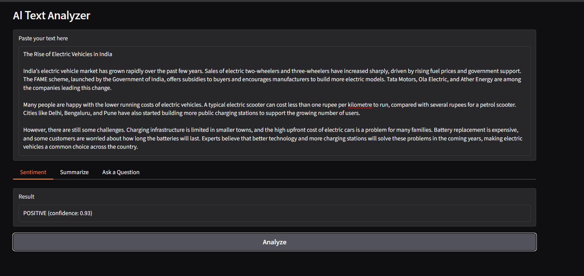
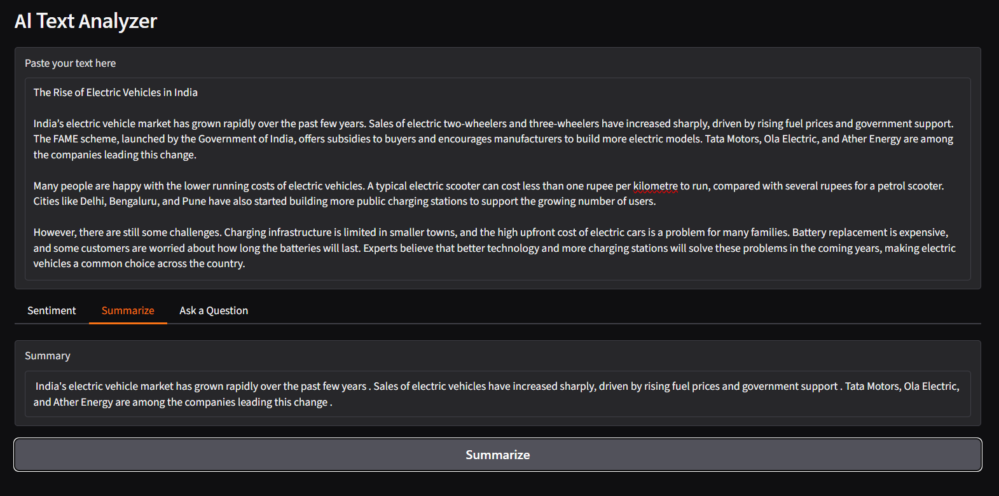
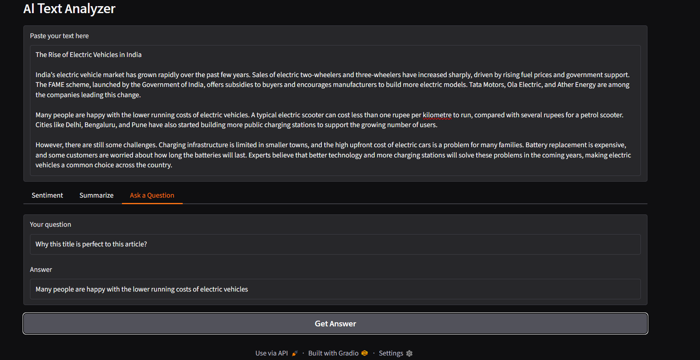

# AI Text Analyzer

A mini project on Artificial Intelligence that analyzes any text using pretrained
**Hugging Face Transformers** models, with a web interface built using **Gradio**.

**Live demo:** https://9728e03eed8bd3378c.gradio.live/ *(temporary link, may expire)*

## Features
- **Sentiment analysis**: detects whether the text is POSITIVE or NEGATIVE, with a confidence score
- **Summarization**: creates a short summary of a long paragraph or article
- **Question answering**: answers a question using the pasted text as context

## Models used
| Task | Model |
|---|---|
| Sentiment analysis | `distilbert-base-uncased-finetuned-sst-2-english` |
| Summarization | `sshleifer/distilbart-cnn-12-6` |
| Question answering | Hugging Face default question-answering model |

## Tech stack
Python, Hugging Face Transformers, PyTorch, Gradio, Google Colab

## How to run

**On Google Colab**
```python
!pip install "transformers<5" gradio torch
```
Restart the session, then run the code from `app.py` in a cell.

**On your computer**
```bash
git clone https://github.com/<your-username>/ai-text-analyzer.git
cd ai-text-analyzer
pip install -r requirements.txt
python app.py
```
Open the local link shown in the terminal.

> `transformers<5` is required because version 5 removed the summarization pipeline.

## Screenshots
| Sentiment | Summarize | Ask a Question |
|---|---|---|
|  |  |  |

## Limitations
- Sentiment gives one label for the whole text, so mixed articles may be labelled wrongly
- Question answering only extracts text that exists in the paragraph; "why" questions can give weak answers
- Works best with English text; very long text is truncated by the models

## Future scope
PDF upload, more languages, voice input, deployment on Hugging Face Spaces.
